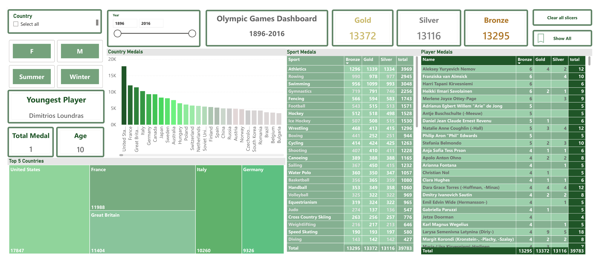

# Olympic-Games-Dashboard-PowerBI
An interactive Power BI dashboard analyzing Olympic medals from 1896 to 2016, covering both Summer and Winter Games.
## Key Metrics
- Total medals: 39,783 (Gold 13,372, Silver 13,116, Bronze 13,295)
- Top 5 countries: United States, France, Great Britain, Italy, Germany
- Top sport by medals: Athletics (3,969)
## What the dashboard shows
- Medals by country
- Top 5 countries by total medals
- Medals by sport (Bronze, Gold, Silver, total)
- Medals by player
- Youngest player and age
## Interactivity
- Filters for country, year range (1896-2016), gender (F/M), and season (Summer/Winter)
- Clear all slicers button to reset the filters
- Winter-only view available through the season filter
## Tools
- Power BI
- Power Query: data cleaning and transformation
- DAX: calculated measures for medal counts and player statistics
## Files
- Dashboard Profisional0.pbix: Power BI project file
- Dashboard_Profisional.pdf: PDF preview

